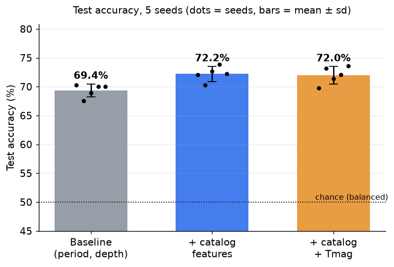
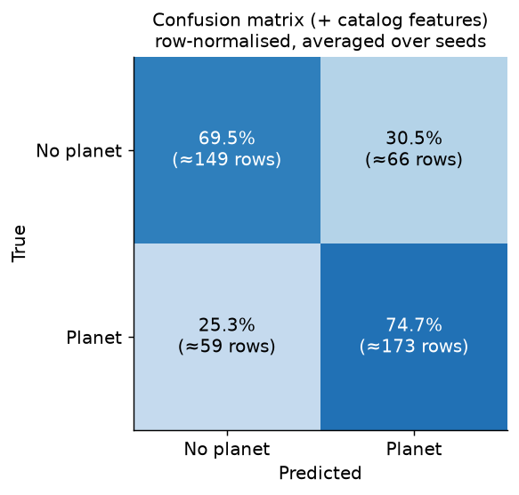
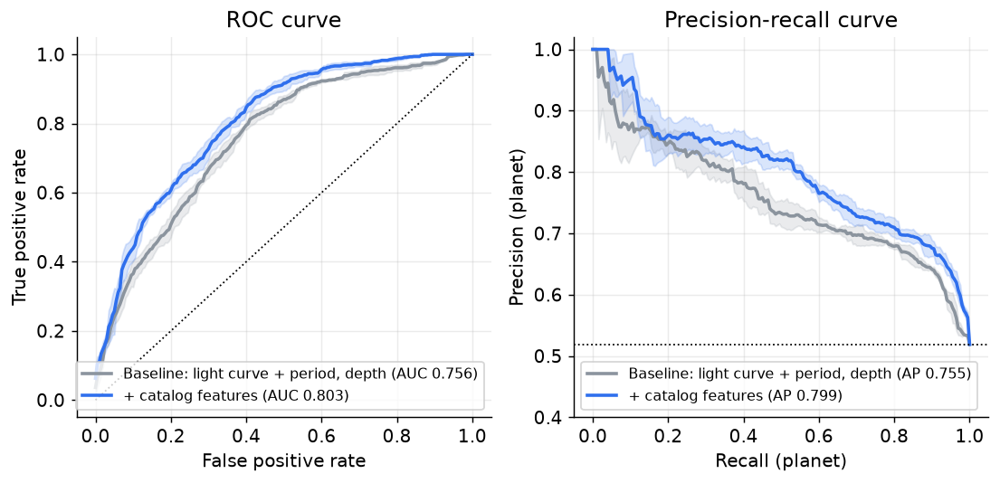
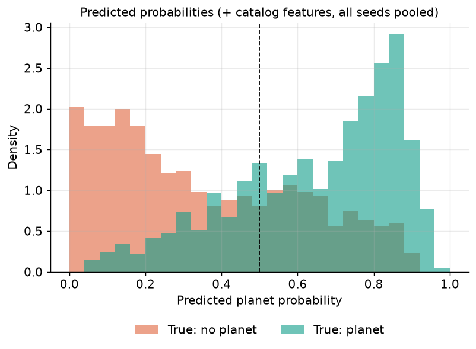
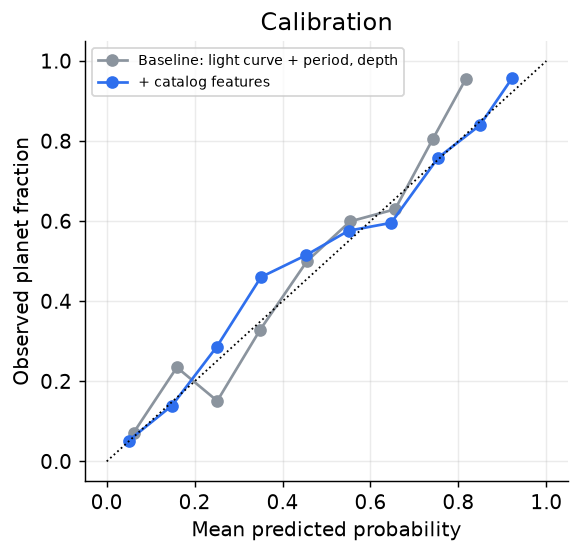
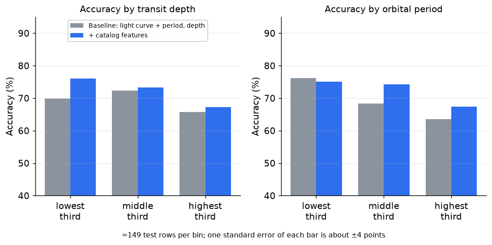
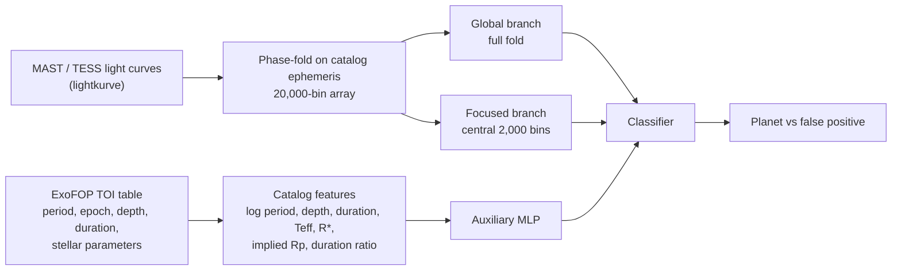

# TESS-Vet: Vetting TESS Exoplanet Candidates with a Dual-Branch 1D-CNN

  

**A deep-learning pipeline that classifies and separates real planet candidates from false positives (such as eclipsing binaries, stellar variability and other astrophysical phenomenon) in NASA TESS data.**


By combining phase-folded light curves with physics-derived catalog features (implied planet radius, transit-duration ratio, stellar parameters), TESS-Vet reaches
**72.2% test accuracy**, a **+2.9-point gain (about +4% relative)** over an AstroNet-style baseline that held on all 5 of 5 training seeds.


Note: This project was built, trained and evaluated end to end on a M1 MacBook Air with 8 GB RAM, which is a serious hardware constraint.

## TESS-Vet Results overview

| | |
|---|---|
| **72.2%** | test accuracy of the headline model (baseline: 69.4%) |
| **+2.9 points** | gain from catalog features, positive on 5 / 5 seeds |
| **0.803 ROC-AUC** | up from 0.756 for the baseline |
| **0.799 average precision** | up from 0.755 for the baseline |
| **74.7% planet recall** | 173 of 232 true planets found on the test set (seed-averaged) |
| **2,231** | TESS candidates with phase-folded light curves (1,561 train / 223 validation / 447 test) |
| **15** | final models trained (3 configurations x 5 seeds), all with saved test predictions |
| **7** | Documented problems which were fixed (depth shortcut, test-set selection bias and others) |
| **12** | stars used to validate a difference-image centroid vetting study (clean-star offsets 0.1 to 0.3 px, a known background blend recovered at 1.75 px) |

## Highlights

* **Physics-informed features.** The implied planet radius (`sqrt(depth) x stellar radius`) flags eclipsing binaries that a light curve alone can hide, and the duration ratio checks whether the transit length makes sense for the star and orbit.
* **Dual-branch architecture.** A global view of the whole fold and a focused view of the transit, merged with an auxiliary branch for the scalar features.
* **Trustworthy evaluation.** Train / validation / test protocol, 5 seeds per configuration, bootstrap confidence intervals, ROC and precision-recall curves, calibration and per-bin accuracy.
* **Reproducible.** Pinned dependencies, one script that rebuilds every figure and table from the saved test predictions, and a data-release for the processed light curves.

## Results

<!-- RESULTS:START -->
| Model | Accuracy (%) |
|---|---|
| Baseline: light curve + period, depth | 69.35 ± 1.13 |
| + catalog features | 72.22 ± 1.30 |
| + catalog features + Tmag | 71.99 ± 1.51 |


<!-- RESULTS:END -->

<table>
<tr>
<td width="50%"></td>
<td width="50%"></td>
</tr>
<tr>
<td colspan="2"></td>
</tr>
<tr>
<td width="50%"></td>
<td width="50%"></td>
</tr>
<tr>
<td colspan="2"></td>
</tr>
</table>

Notes:

* The catalog features add roughly **+2.9 points** over period and depth alone, positive on all 5 seeds. TESS magnitude (Tmag) adds nothing under the clean protocol and is excluded from the headline model.
* All numbers come from one fixed 80/20 split. The binomial standard error of a 447-row test set is ~2.1 points.
* Predictions for every test row and seed are in `results/test_predictions.csv`.

## Method



* Per-sample z-score normalisation (prevents transit-depth shortcut), `BCEWithLogitsLoss`, Adam with `ReduceLROnPlateau`.
* Implied planet radius is `sqrt(depth) x stellar radius`, a very large value points to an eclipsing binary. The duration ratio compares the observed duration to a central transit for the star and period.
* Train / validation / test: validation drives checkpointing, the LR schedule and the threshold; the test set is evaluated once per seed (`src/run_protocol.py`).

## Rigor: problems found and fixed

| Problem | Description | Solution |
|---|---|---|
| Depth shortcut | Model scored deep candidates higher regardless of shape | Per-sample z-score normalisation + shallow/deep probability check as a standing diagnostic |
| Numerical overflow | `inf` loss in evaluation | `BCEWithLogitsLoss` instead of sigmoid + `BCELoss` |
| Mode collapse | Flat predictions | Centre at 0, clamp ±0.1, scale x10 |
| Padding / roll cliffs | Data at lightcurve edges misclassified as transits | Symmetric padding, restricted shift augmentation |
| Non-finite log features | Silent contamination due to zero periods | Drop non-finite rows before training |
| Test-set selection bias | Test set used for checkpointing / LR / threshold inflated one result by about 1.5 points | Train / validation / test protocol (`src/run_protocol.py`) |
| Stacking | Underperformed the single model | Documented in `notebooks/archive/08_CNN_stack.ipynb` |

## Centroid sub-study (background blends)

Difference-image centroiding with [`transit-diffImage`](https://github.com/stevepur/transit-diffImage) was validated on known clean stars and known background
false positives: after fixing a one-pixel stellar-aberration reference error, clean stars showed 0.1-0.3 px offsets
and one known blend was detected at 1.75 px. Using SPOC light-curve centroid columns as a scalable feature was piloted
but dropped since downloads ran at about 5 stars/hour, and a 48-star pilot was too small to be conclusive. Details in `centroid/`.
Limitation: clean targets with bright neighbours were not tested.

## Repository layout

```
src/            data_setup.py, models.py, run_protocol.py (clean protocol), build_aux_features.py, fetch_data.py
experiments/    catalog_baseline.py, catalog_ablation.py, make_results.py (figures + metrics)
results/        figures (fig_*.png), metrics.md / metrics.json, test_predictions.csv
centroid/       centroid_checks.py, check_spoc_coverage.py, extract_centroid_features.py, results/
notebooks/      01_Exploration (data pre-processing walkthrough), 02_NASA_ETL_Pipeline, 03_CNN_baseline, 04_CNN_final;
                archive/ holds earlier iterations
data/           processed_labels_v2.csv (labels + catalog columns), processed_labels_v3.csv (+ engineered features); light curves are NOT included
models/         trained weights of the final configuration (5 seeds)
```

## Reproducing

```bash
uv venv && source .venv/bin/activate            # or python -m venv .venv
uv pip install -r requirements.txt
# 1. Light curves (176 MB of processed arrays, not in the repo). Either download lightcurves_v2.zip from the Releases page
#    (https://github.com/AstroVall02/TESS-Vet-CNN/releases/tag/v1.0) and unzip so you get data/lightcurves_v2/, or rebuild from MAST (slower): src/fetch_data.py + notebooks/02_NASA_ETL_Pipeline.ipynb
# 2. Build the engineered features
python src/build_aux_features.py data/processed_labels_v2.csv --out data/processed_labels_v3.csv
# 3. Train / evaluate (from a notebook, see notebooks/04_CNN_final.ipynb)
#    from run_protocol import run_protocol
# 4. Rebuild metrics and figures from the saved test probabilities
python experiments/make_results.py --csv data/processed_labels_v3.csv --data-dir data/lightcurves_v2 --probs-dir results/probs --readme README.md
```

Notebooks add `../src` to `sys.path` to import the modules.

## Data and credits

* Light curves: NASA MAST / TESS (via `lightkurve`).
* Candidate catalog and labels: ExoFOP-TESS TOI table (TFOPWG dispositions), downloaded July-Sept 2026. **Label 1** = KP, CP or PC (known planet, confirmed planet, planetary candidate);
  **label 0** = FP or FA (false positive, false alarm). Unclassified rows are dropped. Classes are balanced by random down-sampling (seed 42).
* Difference-image centroiding: [`transit-diffImage`](https://github.com/stevepur/transit-diffImage) (third-party, not vendored; see `centroid/README.md`).
* Approach follows Shallue & Vanderburg (2018), Yu et al. (2019) and Ansdell et al. (2018).

## Limitations

* One fixed split without cross-validation (hardware compute limitation).
* "Planet" (label 1) includes unconfirmed planetary candidates (PC), which are vetted as planets but are yet to be confirmed.
* The dataset is class-balanced by construction (about 50/50), so accuracy here is not comparable to a real-world candidate stream, where false positives dominate.
* Dispositions change over time. `data/processed_labels_v2.csv` is a snapshot of the ExoFOP table at download time.
* Catalog features can encode vetting-process effects (brighter stars may get more follow-up, so more of their false positives may be resolved). Tmag gave no gain under the clean protocol and was dropped.
* A gradient-boosted tree on the catalog columns reaches a similar accuracy (`experiments/catalog_baseline.py`).

## License

Released under the [MIT License](LICENSE). Copyright (c) 2026 <VALLABH KAVI>.